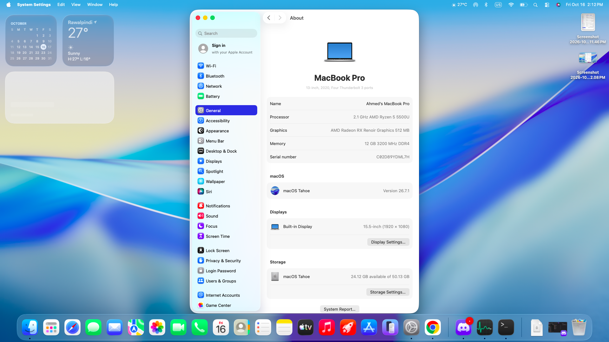

# Hackintosh EFI for HP 15s-EF2127WM laptop 

This repository contains the EFI setup I used to successfully boot macOS on my HP laptop with AMD CPU.

I have tested this configuration on:

- **macOS Tahoe 26**

Previous versions may also work (as low as Catalina).

---

## Hardware Specs

### ✅ Supported
- **CPU:** AMD Ryzen 5 5500U  
- **GPU:** AMD Radeon Graphics  
- **Audio:** Realtek(R) ALC236 (working with layout-id 3, speakers OK)  
- **Wi-Fi:** Realtek RTL8822CE 802.11ac PCIe Adapter  
- **Storage Controller:** Gold P31/BC711/PC711 NVMe SSD  
- **Bluetooth:** Realtek Bluetooth 5 Adapter  
- **Camera:** Crashes on capture in some apps but can work in online meetings, facetime,etc. 

---

## Installation Reference

I followed [Dortania OpenCore Install Guide](https://dortania.github.io/OpenCore-Install-Guide/) and [OpCore-Simplify](https://github.com/lzhoang2801/OpCore-Simplify) to set up this Hackintosh.  
